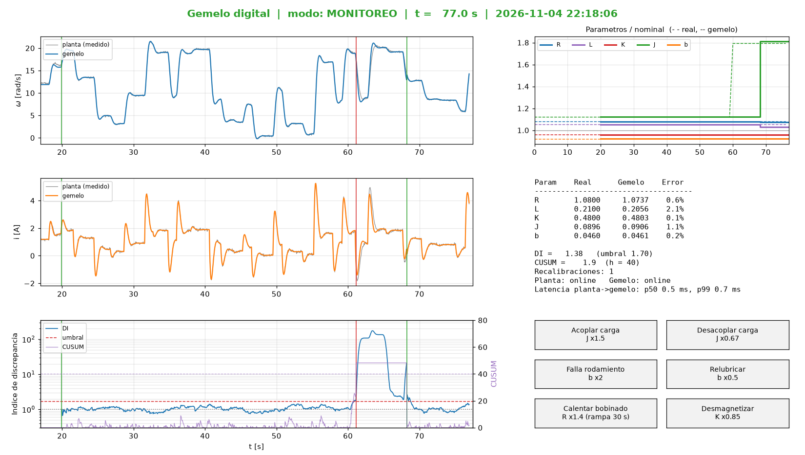
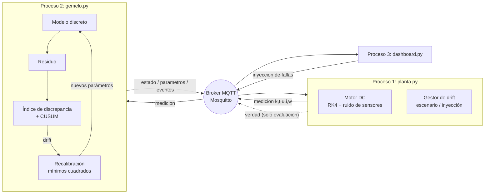
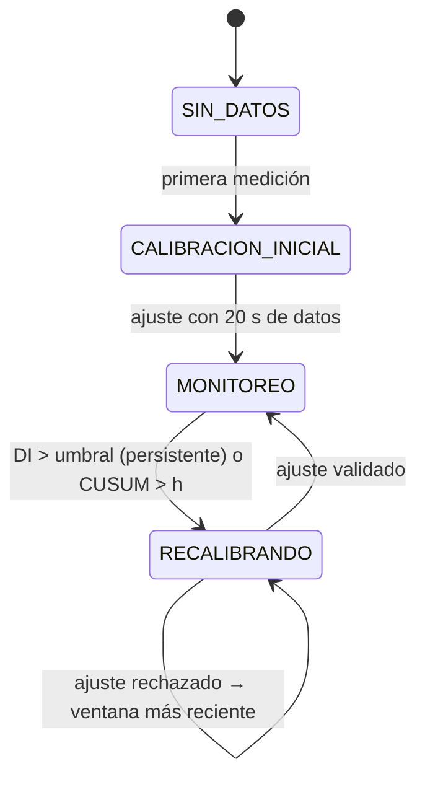
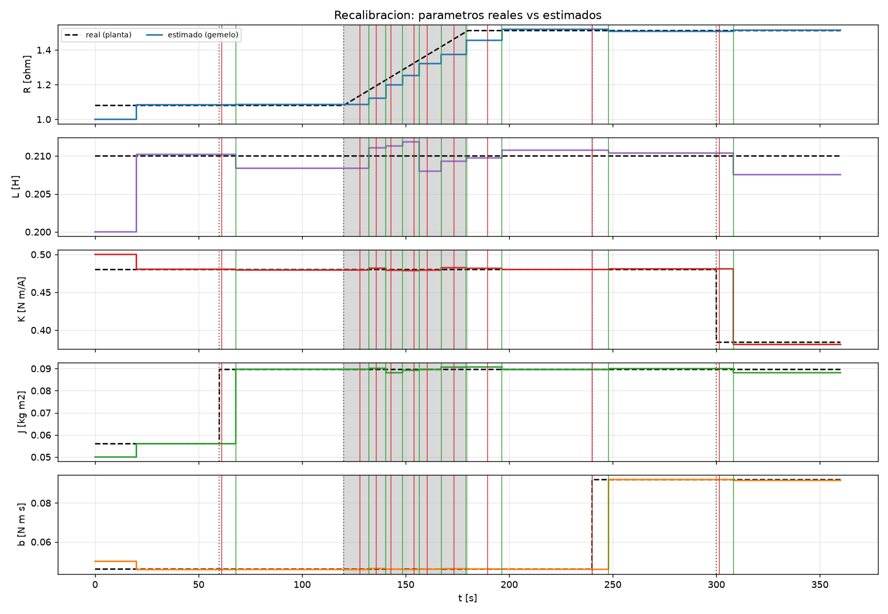
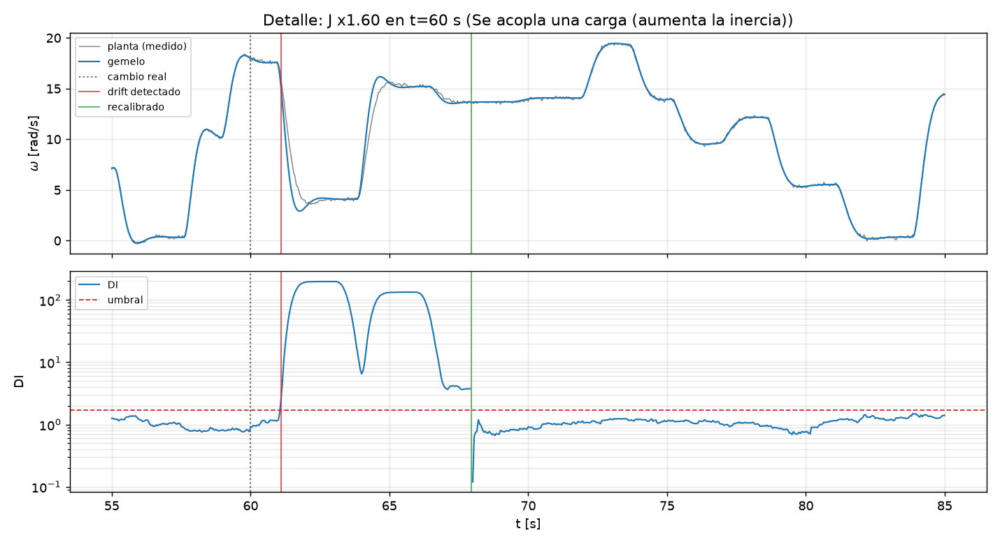

# Gemelo digital con detección de drift y recalibración

Proyecto Integrador S4 del ramo *Análisis y Diseño de Sistemas Ciber-Físicos* (Universidad de Concepción, 2026-2).

Una **planta** (motor DC simulado) y su **gemelo digital** corren como **procesos separados** que
se comunican **sólo por MQTT**. La planta cambia sus parámetros físicos **sin aviso** (se acopla
una carga, se calienta el bobinado, se desgastan los rodamientos…). El gemelo lo detecta con un
**índice de discrepancia** entre lo que mide la planta y lo que predice su modelo, y se
**recalibra** estimando de nuevo los parámetros por mínimos cuadrados.



---

## 1. Arquitectura



| Tópico (`cps/motor1/...`) | Publica | Contenido | QoS / retain |
|---|---|---|---|
| `planta/medicion` | planta | `{k, t, u, i, w}` cada Ts = 50 ms | 0 |
| `planta/verdad` | planta | parámetros reales (**el gemelo NO se suscribe**) | 0, retenido |
| `planta/inyeccion` | dashboard / CLI | `{param, factor, rampa_s?}` | 1 |
| `planta/conexion` | planta | `online` / `offline` (Last Will) | 1, retenido |
| `gemelo/estado` | gemelo | `{k, t, i_hat, w_hat, DI, cusum, modo}` | 0 |
| `gemelo/parametros` | gemelo | parámetros estimados + σ del ruido | 1, retenido |
| `gemelo/eventos` | gemelo | `drift_detectado`, `recalibrado`, … | 1 |
| `gemelo/conexion` | gemelo | `online` / `offline` (Last Will) | 1, retenido |

Decisiones de diseño:

- **El gemelo usa el índice `k` y el tiempo `t` de los mensajes**, no el reloj del PC: es inmune a la
  latencia de la red y funciona igual a cualquier velocidad de simulación.
- **Mensajes perdidos** (salto en `k`): el gemelo copia la medición a su estado
  (resincronización) y descarta esa muestra para el detector. **Reinicio de la planta** (`k` retrocede):
  se resincroniza y sigue.
- **Last Will (LWT)**: si un proceso muere, el broker publica `offline` en su nombre.
- El núcleo (`cps/`) no depende de MQTT: los mismos objetos se usan en los procesos reales y en la
  simulación offline.

## 2. Planta: motor DC

Estado $x = [i,\ \omega]$, entrada $u = V$:

$$L\,\frac{di}{dt} = V - R\,i - K\,\omega \qquad\qquad J\,\frac{d\omega}{dt} = K\,i - b\,\omega$$

| Parámetro | Placa (lo que sabe el gemelo) | Real inicial (desconocido) | Drift físico típico |
|---|---|---|---|
| R [Ω] | 1.00 | 1.08 | sube con la temperatura del bobinado |
| L [H] | 0.20 | 0.21 | — |
| K [N·m/A] | 0.50 | 0.48 | baja con la desmagnetización de los imanes |
| J [kg·m²] | 0.050 | 0.056 | sube/baja al acoplar/desacoplar una carga |
| b [N·m·s] | 0.050 | 0.046 | sube con el desgaste de rodamientos |

- Se integra con RK4 (20 sub-pasos por muestra); sensores con ruido gaussiano σᵢ = 0.05 A, σ_ω = 0.1 rad/s.
- El voltaje son escalones aleatorios entre 0 y 12 V de 1 a 3 s, lo que da **excitación persistente**:
  sin ella los parámetros no se podrían identificar.
- Escenarios (`--escenario`):
  - `demo`: J×1.6 en t=60 s, R×1.4 en rampa de 60 s desde t=120 s, b×2 en t=240 s y K×0.8 en t=300 s.
  - `aleatorio`: instantes de Poisson y magnitudes aleatorias con sentido físico (`--semilla` lo hace reproducible).
  - `sin_drift`: para medir falsas alarmas.
- Además se pueden inyectar fallas manualmente durante la demo (botones del dashboard o `inyectar_falla.py`).

## 3. Gemelo digital

### 3.1 Simulación en paralelo

El gemelo usa el mismo modelo discretizado **exactamente** con retención de orden cero
($\Phi = e^{AT_s}$, $\Gamma = \int_0^{T_s} e^{A\tau}d\tau\,B$) y corre **en lazo abierto**: en cada muestra predice
$\hat{x}_k = \Phi\hat{x}_{k-1} + \Gamma u_{k-1}$ sin corregirse con la medición. Así cualquier diferencia de parámetros
se acumula en el residuo en vez de quedar oculta.

### 3.2 Índice de discrepancia (DI)

$$q_k = \frac{1}{m}\sum_{j\in\{i,\omega\}}\left(\frac{y_{j,k}-\hat{y}_{j,k}}{\sigma_j}\right)^2 \qquad DI_k = \frac{1}{W}\sum_{n=k-W+1}^{k} q_n$$

Si el gemelo representa bien a la planta, el residuo es sólo ruido de sensor, así que
$mW\cdot DI \sim \chi^2(mW)$ y **E[DI] = 1**. El umbral sale de esa distribución:
$DI_{umbral} = \chi^2_{1-\alpha}(mW)/(mW)$. Con W = 40 (2 s), m = 2 y α = 10⁻⁴ resulta **1.70**.
Se declara drift cuando DI supera el umbral durante 10 muestras seguidas (persistencia).

σⱼ no se supone: se **estima** de los residuos de la calibración inicial y se refina acumulando los
residuos de cada recalibración validada.

### 3.3 CUSUM (complementario)

$g_k = \max(0,\ g_{k-1} + q_k - 1 - \nu)$, con alarma si $g_k > h$ (ν = 0.5, h = 40). Acumula
discrepancias pequeñas pero persistentes (drift gradual) y entrega una **estimación del instante
de cambio**: la última vez que g valió 0. Ese instante marca dónde empieza la ventana de datos para recalibrar.

### 3.4 Máquina de estados y recalibración



1. Se juntan ≥ 8 s de datos **posteriores** al instante de cambio estimado (máx. 15 s).
2. Se verifica que haya excitación (desviación estándar de V > 0.5 V); si no la hay, se espera.
3. Se resuelve un problema de **mínimos cuadrados del error de simulación** (output-error) con
   `scipy.optimize.least_squares` (Levenberg-Marquardt):

   $$\min_{\theta, x_0}\ \sum_n\sum_j\left(\frac{y_{j,n}-\hat{y}_{j,n}(\theta,x_0)}{\sigma_j}\right)^2 + \lambda^2\,\lVert\ln\theta-\ln\theta_{prev}\rVert^2$$

   Se optimiza en $\ln\theta$, lo que garantiza parámetros positivos y por lo tanto un modelo siempre estable.
   El término λ (pequeño) estabiliza las direcciones poco excitadas.
4. **Validación**: el DI del ajuste sobre su propia ventana debe ser ≤ 1.5. Si no lo es (la ventana mezcla
   datos de antes y después del cambio, o el drift sigue en curso), se reintenta con datos más recientes.
5. Se actualizan los parámetros, se resincroniza el estado con el del ajuste y se reinician DI y CUSUM.

Cada recalibración informa también la **incertidumbre relativa** de cada parámetro, $\sqrt{\mathrm{diag}(J^TJ)^{-1}}$.

## 4. Instalación

Requiere Python ≥ 3.10.

```bash
pip install -r requirements.txt
```

**Broker MQTT** (una de dos opciones):

- **Mosquitto (recomendado)**: instalar desde <https://mosquitto.org/download/> y ejecutar `mosquitto -v`
  (en Windows también queda como servicio en el puerto 1883).
- **Broker de respaldo incluido**, sin instalar nada: `python broker_mini.py`. Es un broker MQTT 3.1.1
  mínimo (QoS 0/1, retenidos, Last Will, comodines) pensado para desarrollo.

## 5. Ejecución

### Opción A: todo de una vez

```bash
python lanzar_demo.py --broker-mini --velocidad 2
```

Abre una consola por proceso (broker, gemelo, planta) más el dashboard. Si Mosquitto ya está corriendo, se omite `--broker-mini`.

### Opción B: cada proceso en su terminal (recomendado para la presentación)

```bash
python broker_mini.py          # o: mosquitto -v
python gemelo.py
python planta.py --velocidad 2 # --escenario aleatorio --semilla 7
python dashboard.py
```

Inyectar fallas a mano (además de los botones del dashboard):

```bash
python inyectar_falla.py J 1.5
python inyectar_falla.py R 1.4 --rampa 30
mosquitto_pub -t cps/motor1/planta/inyeccion -m "{\"param\":\"b\",\"factor\":2}"
```

Planta y gemelo pueden correr en **PCs distintos**: broker con `--host 0.0.0.0` (o Mosquitto con
`listener 1883` y `allow_anonymous true`) y los demás procesos con `--host <ip-del-broker>`. Para que
la latencia medida sea válida, ambos PCs deben tener el reloj sincronizado (NTP).

**Broker seguro** (autenticación, ACL de mínimo privilegio y TLS): ver
[config/mosquitto/README.md](config/mosquitto/README.md). Los clientes aceptan `--usuario`, `--clave` y
`--tls-ca`, o las variables de entorno `MQTT_USUARIO`, `MQTT_CLAVE` y `MQTT_TLS_CA`.

Al terminar, los registros quedan en `logs/`. Cada muestra lleva la marca de tiempo real con que la
planta la publicó, y las consolas imprimen fecha y hora. Para obtener métricas, KPIs y figuras
(incluidas latencia y pérdida de mensajes):

```bash
python analisis.py logs
```

### Simulación offline y experimentos

```bash
python simulacion_offline.py --escenario demo --duracion 360   # ~3 s, deja figuras en logs/offline/figuras
python experimentos.py --semillas 10                           # evaluación Monte Carlo
python -m unittest -v                                          # pruebas
```

## 6. KPIs y resultados

Las metas están en `cps/config.py` (`METAS_KPI`); `analisis.py` y `experimentos.py` imprimen cada KPI
junto a su meta e indican si se cumple. Valores de la Entrega 1:

| KPI | Meta | Medido | Fuente |
|---|---|---|---|
| KPI1 Tasa de detección | ≥ 95 % | 100 % (103 detectados + 4 absorbidos de 107) | Monte Carlo |
| KPI2 Retardo de detección | mediana ≤ 2 s, p90 ≤ 10 s | 0,80 s / 5,95 s | Monte Carlo |
| KPI3 Falsas alarmas | ≤ 1 por hora | 0,86 por hora | Monte Carlo |
| KPI4 Error de recalibración | mediana ≤ 2 %, p90 ≤ 5 % | 0,44 % / 1,75 % | Monte Carlo |
| KPI5 Tiempo de recuperación | mediana ≤ 12 s | 8,3 s | Monte Carlo |
| KPI6 Latencia planta → gemelo | p99 ≤ 25 ms | 0,89 ms | corrida MQTT en tiempo real |
| KPI7 Pérdida de mensajes | ≤ 0,1 % | 0 % (2600/2600) | corrida MQTT en tiempo real |

La corrida MQTT del 04-11-2026 (registros CSV/JSONL, consolas con fecha, captura del dashboard y
figuras) está en [docs/evidencia/hito1](docs/evidencia/hito1); el resumen del Monte Carlo, en
[docs/evidencia/resultados_montecarlo.json](docs/evidencia/resultados_montecarlo.json).

Escenario `demo` (offline, semilla 1):

| Cambio real | Retardo de detección | Error del instante estimado | Recalibraciones | Error final del parámetro |
|---|---|---|---|---|
| J ×1.6 escalón, t = 60 s | 1.10 s | 0.00 s | 1 | 0.1 % |
| R ×1.4 rampa 60 s, t = 120 s | 7.80 s | 4.25 s | 7 (sigue la rampa) | 0.5 % |
| b ×2 escalón, t = 240 s | 0.15 s | 0.00 s | 1 | 0.0 % |
| K ×0.8 escalón, t = 300 s | 1.40 s | 0.25 s | 1 | 0.8 % |

Monte Carlo (`experimentos.py`: 10 escenarios aleatorios de 900 s más 1 h sin drift, 3.5 h en total):

| Métrica | Valor |
|---|---|
| Cambios detectados | 103/107 (los otros 4 ocurrieron durante una recalibración y quedaron incorporados en ella) |
| Falsas alarmas | 0.86 por hora |
| Retardo de detección | mediana 0.80 s, p90 5.95 s |
| Error del parámetro que cambió, tras recalibrar | mediana 0.44 %, p90 1.75 % |
| Tiempo de cómputo de una recalibración | 5–25 ms |




Observaciones para la discusión:

- **Observabilidad**: un cambio de J o de b sólo se nota en la salida cuando hay transitorios. Si el
  cambio ocurre con el voltaje constante, el gemelo lo detecta en el siguiente escalón (ver la figura de detalle).
  Lo mismo pasa con b si K es grande ($K^2 \gg Rb$): la fricción casi no afecta la velocidad.
- **Drift gradual**: durante una rampa el gemelo se recalibra varias veces y "persigue" el parámetro.
  Es el comportamiento esperado de un esquema por ventanas.
- **Compromiso detección / falsas alarmas**: subir `persistencia` o bajar `alfa` reduce las falsas
  alarmas a costa de más retardo. Una falsa alarma sólo cuesta una recalibración innecesaria, porque la
  validación y la regularización impiden que los parámetros empeoren.

## 7. Estructura

```
cps/
  config.py        parámetros del experimento, tópicos, detector y metas de los KPI
  modelo.py        ecuaciones del motor, RK4, discretización exacta, simulación
  planta_sim.py    planta "real": integración, ruido, escenarios de drift, entrada
  gemelo_core.py   validación de mensajes, índice de discrepancia, CUSUM, recalibración
  mqtt_util.py     conexión paho-mqtt con LWT, reconexión, credenciales y TLS
  registro.py      CSV / JSONL con marcas de tiempo
planta.py          PROCESO 1  planta en tiempo real (MQTT)
gemelo.py          PROCESO 2  gemelo digital (MQTT); mide latencia por muestra
dashboard.py       PROCESO 3  visualización + botones de fallas (MQTT)
broker_mini.py     broker MQTT mínimo de respaldo
inyectar_falla.py  inyección de fallas por línea de comandos
lanzar_demo.py     levanta todos los procesos
simulacion_offline.py / experimentos.py / analisis.py   evaluación, KPIs y figuras
config/mosquitto/  configuración segura de Mosquitto (usuarios, ACL, TLS)
docs/              figuras, diagrama de arquitectura (generar_diagrama.py) y evidencia del hito 1
tests/             pruebas unitarias y de integración
```

## 8. Guía para leer el código

Cada archivo empieza con una explicación de qué hace y cómo encaja en el sistema. Un orden de
lectura que va de lo concreto a lo abstracto:

1. `cps/config.py`: todas las constantes en un solo lugar (tópicos, parámetros, umbrales, metas).
2. `cps/modelo.py`: las dos ecuaciones del motor y cómo se simulan.
3. `cps/planta_sim.py`: la planta "real", con ruido y cambios sin aviso.
4. `cps/gemelo_core.py`: el corazón del proyecto. `GemeloDigital.procesar()` es la función que
   recorre todo el algoritmo para una muestra.
5. `planta.py` y `gemelo.py`: cómo se conectan esas dos piezas por MQTT.
6. `analisis.py`: cómo se calculan los KPI a partir de los registros.

El recorrido de **una medición** por el sistema, cada 50 ms:

1. `planta.py` llama a `PlantaSimulada.paso()`, que aplica los cambios de parámetros que tocan,
   elige el voltaje, mide i y ω con ruido e integra la física hasta la muestra siguiente.
2. La planta publica `{k, t, ts, u, i, w}` en `cps/motor1/planta/medicion` y lo anota en `planta.csv`.
3. El broker reenvía el mensaje a quienes estén suscritos: el gemelo y el dashboard.
4. En `gemelo.py`, el hilo de MQTT pone el mensaje en una cola; el ciclo principal lo saca y
   llama a `GemeloDigital.procesar()`.
5. `procesar()` valida el mensaje, predice con el modelo, calcula el residuo, actualiza el DI y
   el CUSUM, y si hay drift junta datos y se recalibra con `ajustar_parametros()`.
6. El gemelo publica su estado en `gemelo/estado` (y sus eventos en `gemelo/eventos`) y lo anota en `gemelo.csv`.
7. El dashboard dibuja lo que recibió de la planta y del gemelo.

Para probar una pieza sin red, `simulacion_offline.py` hace los pasos 1 y 5 en un solo proceso.

## 9. Posibles extensiones

- Observador (filtro de Kalman) en paralelo para separar el drift de las perturbaciones de carga.
- Torque de carga desconocido como sexto parámetro, o fricción de Coulomb (planta no lineal).
- Ruido de proceso y su efecto sobre el umbral (residuos coloreados).
- Persistencia de datos en InfluxDB y dashboard en Grafana o Node-RED.
